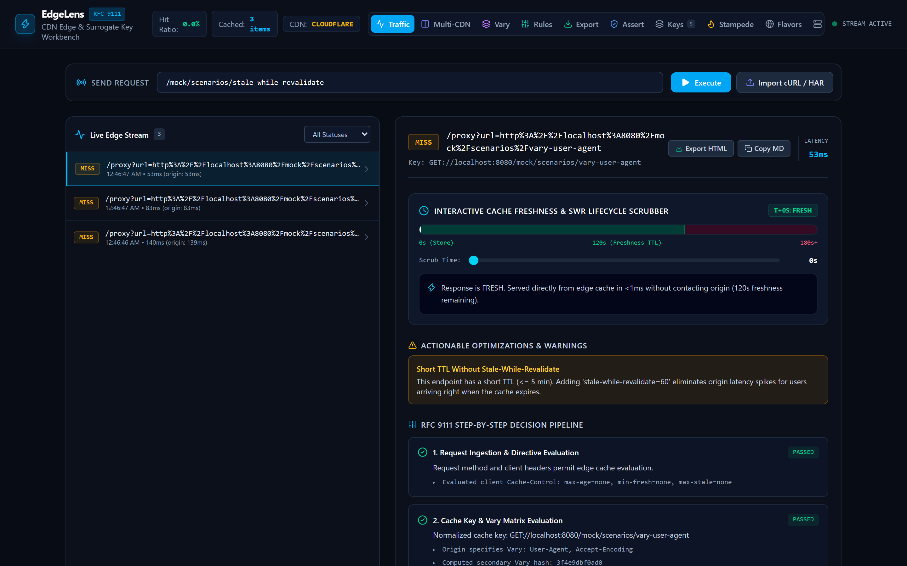
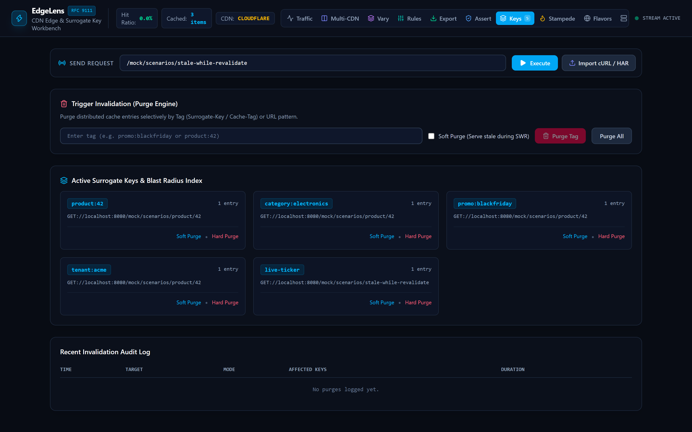
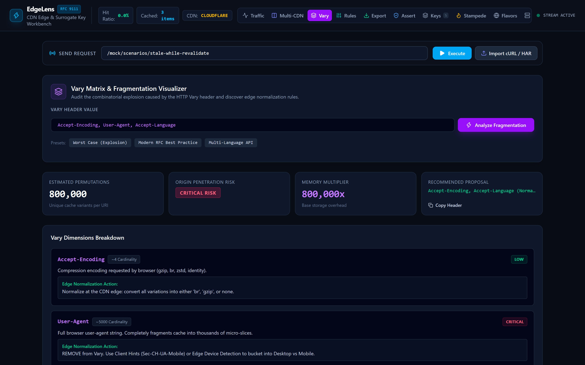
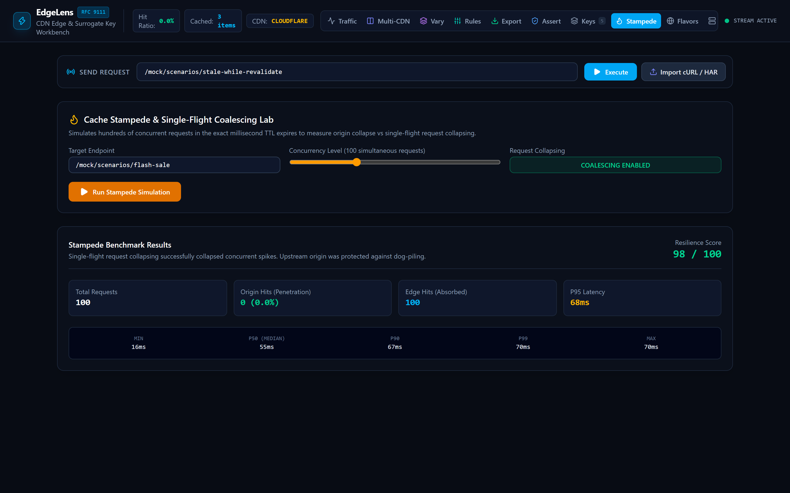
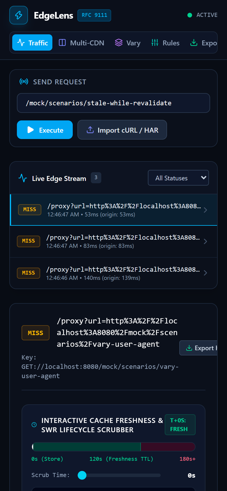

<p align="center">
  
</p>

<h1 align="center">EdgeLens</h1>

<p align="center">
  <strong>RFC 9111 HTTP Caching Engine, CDN Edge Invalidation &amp; Surrogate Key Workbench</strong>
</p>

<p align="center">
  
  
  
  
</p>

<p align="center">
  
</p>

EdgeLens is an RFC 9111 HTTP caching engine, CDN edge proxy emulator, surrogate key invalidator, and cache stampede simulator. It provides developers and site reliability engineers with a local environment to diagnose edge caching behaviors, test cache tags locally, simulate origin stampedes, and verify multi-CDN status headers without deploying code to commercial edge networks.

---

## Capabilities

- **RFC 9111 HTTP Caching Engine**: Implements the HTTP caching specification in Go. Evaluates freshness lifetimes, computes accurate `Age` headers, and supports conditional revalidation (`If-None-Match`, `If-Modified-Since`, 304 Not Modified).
- **Multi-CDN Side-by-Side Comparator**: Evaluates identical URLs simultaneously across Cloudflare, Fastly, AWS CloudFront, Vercel Edge, and RFC 9111, isolating status discrepancies, header differences, and TTL variations.
- **Vary Matrix & Fragmentation Visualizer**: Computes permutation counts, risk ratings, and memory overhead multipliers for unconstrained `Vary` combinations with concrete header normalization recommendations.
- **Edge Rules & Transform Engine**: In-memory rule evaluation pipeline supporting query argument stripping, tracking cookie suppression, synthetic TTL overrides, and surrogate key injection.
- **Production CDN Config Exporter**: Generates copy-paste configuration files for Nginx (`proxy_cache_valid`), Fastly VCL (`vcl_backend_response`), Cloudflare Terraform, and AWS CloudFront CachePolicy.
- **CI/CD Cache Assertion Runner (`edgelens assert`)**: Headless verification command checking cache status, min TTL, compliance grade, and header requirements with exit codes for deployment gates.
- **cURL & HAR (HTTP Archive) Importer**: Imports requests from pasted cURL commands or browser HAR waterfall exports directly into the edge test proxy.
- **Interactive SWR Lifecycle Scrubber**: Visual timeline explaining the exact state (Fresh, Stale-While-Revalidate, Expired) at any point in time with simulated time offset scrubbing.
- **Surrogate Key & Cache-Tag Invalidation**: Extracts tags from `Surrogate-Key`, `Cache-Tag`, and `Edge-Cache-Tag`. Supports instant hard purges, soft purges (serving stale during revalidation), and URL wildcard purges.
- **Cache Stampede (Dog-Piling) Lab**: Simulates 10 to 500 concurrent requests at the exact millisecond of TTL expiration. Toggles single-flight request collapsing on and off to evaluate origin load.
- **Stale-If-Error High-Availability Failover**: Emulates RFC 5861 failover by serving stale cached copies when origin servers encounter 5xx errors or connection failures.
- **Embedded Mock Origin Sandbox**: Runs 8 pre-configured challenge scenarios to test leaky cookies, Vary fragmentation, zero-downtime stale-while-revalidate, and conditional ETags.
- **Exportable Diagnostic Reports**: 1-click standalone HTML and Markdown report generation for incident retrospectives and CDN architecture reviews.
- **Edge Header Linter & Auditor**: Grades response headers on a scale from A+ to F, identifying security vulnerabilities like public Set-Cookie leaks and unconstrained Vary directives.

---

## Visual Interface Overview

| Workspace | Purpose |
|---|---|
| **Traffic &amp; Explainer** | Real-time streaming table of requests with status badges, response latencies, and 5-phase RFC 9111 diagnostic breakdowns |
| **CDN Comparator** | Side-by-side evaluation across Cloudflare, Fastly, CloudFront, Vercel, and RFC 9111 with divergence matrix |
| **Vary Matrix** | Interactive permutation calculator, risk score, memory overhead multiplier, and normalization rules |
| **Edge Rules** | Custom rule pipeline for query argument normalization, cookie stripping, TTL overrides, and tag injection |
| **Surrogate Keys** | Active tag index, blast radius entry counts, 1-click hard and soft tag purging, and audit logs |
| **Stampede Lab** | Concurrency load generator measuring origin penetration, latency percentiles, and request collapsing efficiency |
| **CDN Exporter** | Generate production-ready configuration code for Nginx, Fastly VCL, Cloudflare Terraform, and CloudFront |
| **CI Assertions** | Interactive assertion builder and runner with copyable CLI flags for GitHub Actions and CI pipelines |
| **Mock Origin** | 8 pre-built test scenarios and dynamic route sandbox with adjustable latency and header controls |
| **CDN Flavors** | Switch edge header injection between Cloudflare, Fastly, AWS CloudFront, Vercel Edge, and RFC 9111 |
| **Header Linter** | Compliance audit tool checking headers against edge performance and security guidelines |

<p align="center">
  
  
</p>

<p align="center">
  
  
</p>

<p align="center">
  
</p>

---

## Quick Start

### Installation

Compile directly from source with Go 1.23+:

```bash
# Clone the repository
git clone https://github.com/alexandrmotologa/edgelens.git
cd edgelens

# Build the standalone single binary
go build -o edgelens.exe ./cmd/edgelens
```

### Starting the Workbench

Start the edge proxy, mock origin, and web studio:

```bash
./edgelens.exe serve --port 8080
```

Open `http://localhost:8080` in your browser.

To proxy requests to an existing local development server:

```bash
./edgelens.exe serve --port 8080 --origin http://localhost:3000
```

---

## Command Line Usage

EdgeLens can be run through the visual web studio or operated directly from the terminal.

### 1. Audit Headers and Check RFC 9111 Compliance

Inspect any public or local URL:

```bash
./edgelens.exe inspect https://api.github.com
```

Output:
```text
HTTP Status:   200 OK (Latency: 142ms)
Cache Grade:   B (Score: 85/100)

Relevant Cache Headers:
  Cache-Control: public, max-age=60, s-maxage=60
  Vary:          Accept, Accept-Encoding
  ETag:          "6d412891f9b3"
  Last-Modified: Sun, 18 Oct 2026 19:40:00 GMT
  Age:           24

Audit Findings:
  [LOW] Short TTL Without Stale-While-Revalidate: The resource expires frequently without an SWR window.
        Suggestion: Add 'stale-while-revalidate=60' to serve instant stale hits during revalidation.
```

### 2. Invalidate Cache Entries by Tag or URL

Send invalidation commands to a running EdgeLens instance:

```bash
# Hard purge by surrogate key
./edgelens.exe purge --tag promo:blackfriday

# Soft purge (serve stale while revalidating)
./edgelens.exe purge --tag category:electronics --soft

# Purge by URL prefix
./edgelens.exe purge --url "http://localhost:8080/api/products/*"

# Flush the entire cache store
./edgelens.exe purge --all
```

### 3. Run a Cache Stampede Benchmark

Simulate concurrent traffic hitting an endpoint at the moment of TTL expiry:

```bash
./edgelens.exe stampede --url http://localhost:8080/mock/scenarios/flash-sale -c 100 --coalesce=true
```

Output:
```text
Running Stampede Simulation on: http://localhost:8080/mock/scenarios/flash-sale
Concurrency: 100, Request Collapsing: true

✓ Stampede Completed in 242ms
  Origin Hits (Penetration): 1 / 100 (1.0%)
  Edge Hits (Absorbed):      99
  Resilience Score:          98 / 100

Latency Distribution:
  Min: 210ms | P50: 232ms | P90: 241ms | P95: 242ms | P99: 242ms | Max: 242ms

Summary Note: Single-flight request collapsing successfully collapsed concurrent spikes.
```

### 4. Run CI/CD Cache Assertions

Run headless compliance checks in CI/CD pipelines with deterministic exit codes:

```bash
# Assert that responses have at least 60s TTL, no Set-Cookie, and meet Grade B
./edgelens.exe assert \
  --url http://localhost:8080/api/catalog \
  --min-ttl 60s \
  --disallow-headers "Set-Cookie" \
  --min-grade B

# Output structured JSON for automation scripts
./edgelens.exe assert --url https://api.github.com --min-grade B --json
```

---

## Built-in Test Scenarios

The embedded mock origin server provides 8 realistic challenge scenarios:

1. **Vary User-Agent Fragmentation** (`/mock/scenarios/vary-user-agent`): Demonstrates how unconstrained `Vary: User-Agent` headers fragment cache hit ratios into hundreds of distinct variants.
2. **Leaky Set-Cookie Bypass** (`/mock/scenarios/leaky-cookie`): Simulates origin servers sending session cookies on cacheable assets, which triggers security risks and CDN bypasses.
3. **Stale-While-Revalidate** (`/mock/scenarios/stale-while-revalidate`): Demonstrates instant sub-millisecond stale responses while the edge revalidates asynchronously in the background.
4. **E-Commerce Multi-Tag Purge** (`/mock/scenarios/product/42`): Associates responses with `product:42`, `category:electronics`, and `promo:blackfriday`, demonstrating targeted invalidation.
5. **Cache Stampede Hotspot** (`/mock/scenarios/flash-sale`): Short 2s TTL with 200ms origin delay to test single-flight collapsing under high concurrency.
6. **Conditional ETag Revalidation** (`/mock/scenarios/conditional-etag`): Demonstrates weak and strong ETags returning 304 Not Modified.
7. **Authenticated Endpoint Caching** (`/mock/scenarios/authenticated-feed`): Demonstrates RFC 9111 Section 3.5 rules for caching requests containing `Authorization` headers via `public` or `s-maxage`.
8. **Stale-If-Error High Availability Failover** (`/mock/scenarios/stale-if-error`): Demonstrates RFC 5861 failover serving cached copies with `Age` warning when origin returns 500 (`?fail=true`).

---

## Technical Documentation

- [RFC 9111 HTTP Caching Engine Architecture](docs/RFC_9111_SPEC.md)
- [CI/CD Cache Assertion Runner Guide](docs/CI_CD_ASSERTIONS.md)
- [Surrogate Keys and Inverted Index Purging](docs/SURROGATE_KEYS.md)
- [Single-Flight Request Collapsing and Stampede Protection](docs/STAMPEDE_COALESCING.md)
- [Multi-CDN Flavor Comparison Matrix](docs/CDN_COMPARISON.md)

---

## License

MIT License. Copyright (c) 2026 Alexandr Motologa.
